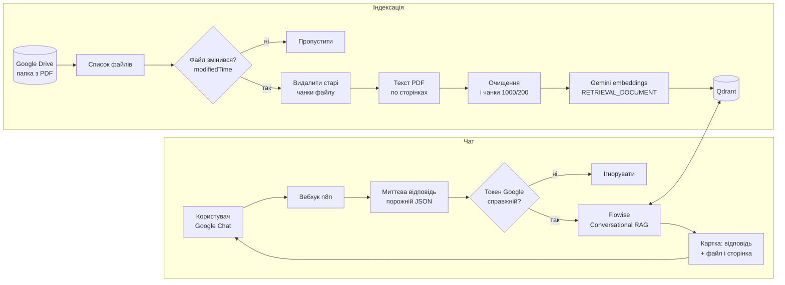
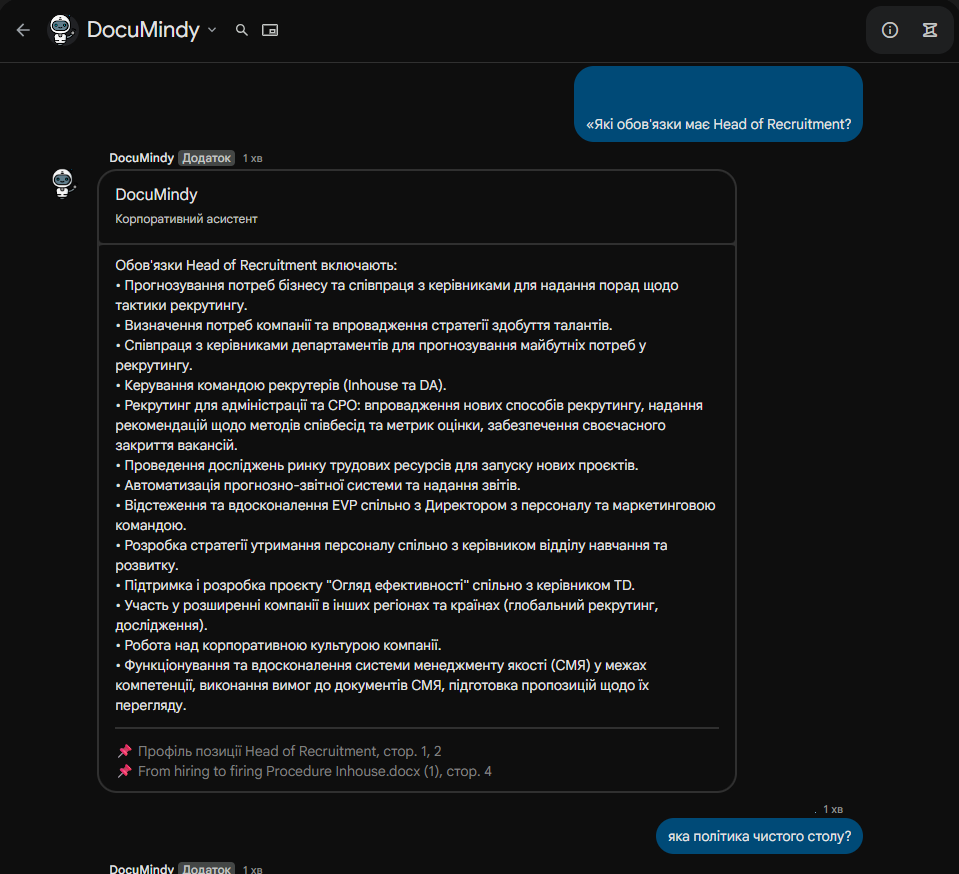
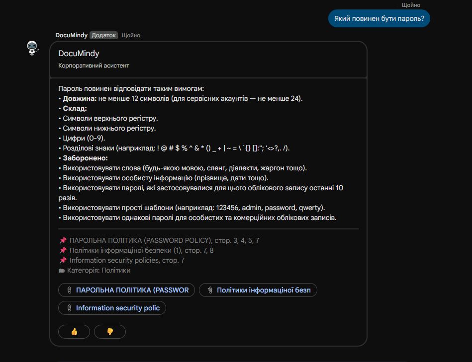
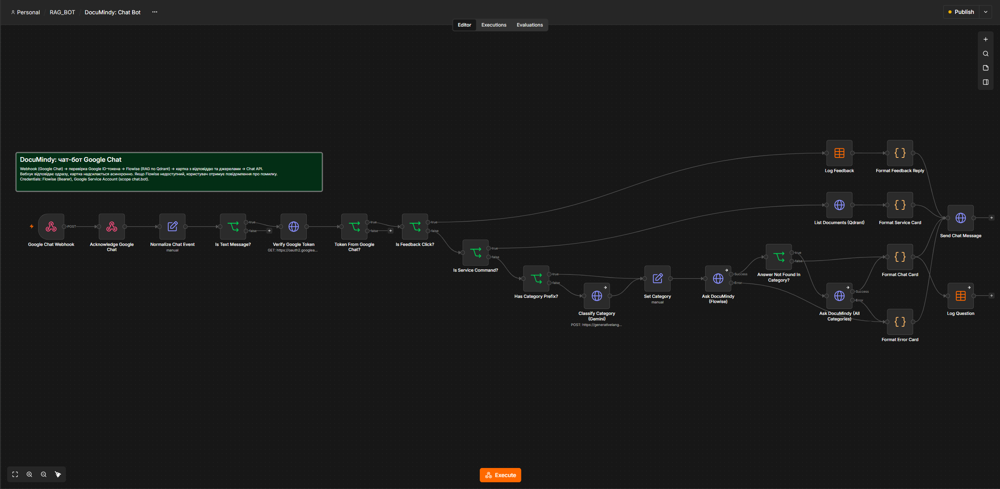
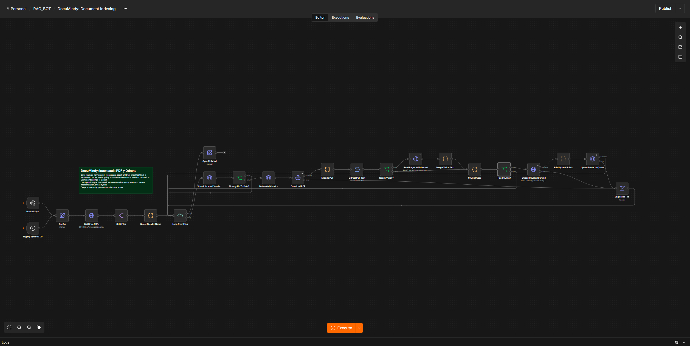
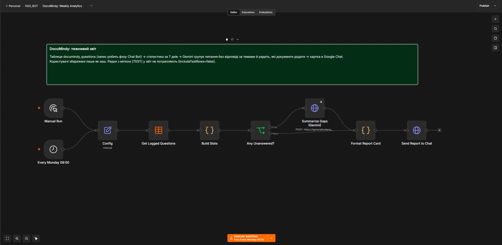
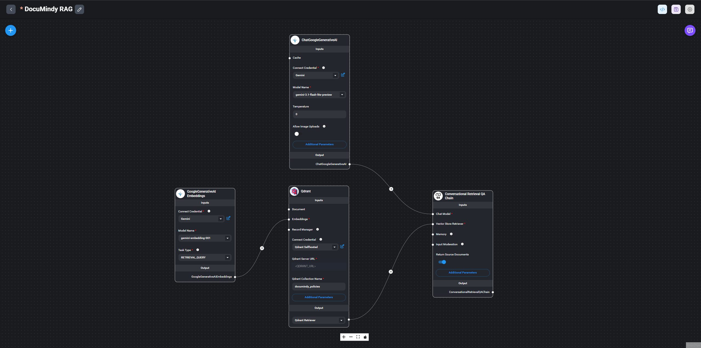

# DocuMindy RAG

> Корпоративний AI-асистент у Google Chat, що відповідає на запитання за внутрішніми політиками й регламентами та вказує джерело (файл і сторінку). Працює на n8n, Flowise, Qdrant і Gemini.

## Опис проєкту

Співробітник пише боту в Google Chat звичайне запитання («Які вимоги до паролів?»). Бот шукає відповідь у базі PDF-документів компанії, відповідає українською лише на основі знайденого тексту й під відповіддю показує, з якого файлу і з якої сторінки вона взята. Якщо відповіді в документах немає, бот прямо про це каже і не вигадує.

Проєкт складається з трьох частин із чітким розподілом ролей:

- **n8n** приймає повідомлення з Google Chat, перевіряє їхню справжність, індексує документи й оформлює відповідь карткою.
- **Flowise** відповідає за сам RAG: пошук у векторній базі та генерацію відповіді з пам'яттю діалогу.
- **Qdrant** зберігає вектори документів.

## Архітектурна схема (Data Flow)



## Флоу

| Флоу | Де | Роль |
|---|---|---|
| Document Indexing | n8n | Індексація PDF із Google Drive в Qdrant: перевірка змін, видалення старих чанків, очищення тексту, чанки, embeddings, запис. Запуск вручну і щоночі о 03:00 |
| Chat Bot | n8n | Вебхук Google Chat: миттєва відповідь, перевірка токена, запит до Flowise, картка з джерелами |
| Weekly Analytics | n8n | Щопонеділка 09:00 надсилає в Google Chat звіт: кількість запитань, найчастіші теми, найпопулярніші документи і те, чого в документах немає (Gemini групує запитання без відповіді за темами й радить, що додати) |
| DocuMindy RAG | Flowise | Chatflow: Qdrant retriever, Gemini embeddings (`RETRIEVAL_QUERY`), Gemini-модель, Conversational Retrieval QA з пам'яттю за сесією |

## Скриншоти

**Відповідь бота в Google Chat** (картка з відповіддю та джерелами: файл і сторінки):





**Флоу в n8n:**







**Chatflow у Flowise** (Gemini, Qdrant retriever, Conversational Retrieval QA):



## Ключові можливості

1. **Відповіді лише з документів.** Промпт забороняє зовнішні знання. Якщо в контексті відповіді немає, бот відповідає фіксованою фразою про відсутність інформації.
2. **Джерела під кожною відповіддю.** Назву файлу й номери сторінок бере n8n з метаданих знайдених фрагментів, а не вгадує модель. Так посилання завжди реальні.
3. **Інкрементальна індексація.** Для кожного файлу порівнюється `modifiedTime` з тим, що вже лежить у Qdrant. Незмінені файли пропускаються, змінені перезаписуються без дублів (старі чанки файлу видаляються перед записом, ID чанків детерміновані).
4. **Якісні чанки.** Колонтитули («Сторінка 3 з 8»), оглавлення й аркуші «Історія змін» відсіюються до embeddings. Інакше короткі службові фрагменти потрапляють у вибірку на будь-яке запитання.
5. **Пам'ять діалогу.** Сесія Flowise = чат + користувач, тож уточнення на кшталт «де це написано?» працюють без тредів.
6. **Аналітика запитань.** Флоу Chat Bot паралельно з відповіддю записує в таблицю n8n (`documindy_questions`) час, обезличений код користувача, запитання, чи знайдено відповідь і головне джерело. Недільний звіт показує прогалини в базі знань, тобто теми, про які питають, а в документах їх немає.
7. **Регресійний тест якості.** `tests/eval_rag.py` (для запитань не про розмітку запускається зі змінною `EVAL_QDRANT_FILTER`, що імітує вибір категорії чатом) ставить 54 запитання (50 з очікуваним документом, 4 без відповіді в базі) і рахує Hit@k, MRR, наявність ключових фактів та чесну відмову. Результат останнього прогону лежить у `tests/baseline.txt`.
8. **Категорії документів.** Кожен фрагмент у Qdrant має тег `metadata.category`: `policy` (політики й процедури), `howto` (інструкції до систем), `hr` (HR, податки, довідки), `role` (профілі посад), `markup` (інструкції з розмітки даних для клієнтських проєктів). Теги задає довідник `docMeta` у `Config` флоу індексації (назва файлу → категорія), тому новий файл потрапляє в базу з потрібною категорією без ручних правок у Qdrant.
9. **Вибір категорії в чаті.** Користувач може почати запитання з префікса: `політики:`, `інструкції:`, `hr:` (також `податки:`), `посади:`, `розмітка:` або `всі:` (без обмеження). Без префікса категорію визначає Gemini за запитанням (вузол `Classify Category (Gemini)`); якщо запитання загальне, пошук іде по всій базі. Фільтр передається у Flowise через `overrideConfig.qdrantFilter`. Якщо в обраній категорії відповіді немає, бот сам повторює пошук по всій базі, тож помилка класифікації не дає хибної відмови. Під відповіддю показується рядок «Категорія: …».
10. **Читання картинок.** Для документів із позначкою `v` у `docMeta` (скани та інструкції, що тримаються на скриншотах і прикладах) флоу індексації надсилає PDF у Gemini (вузол `Read Pages With Gemini`). Gemini повертає для кожної сторінки текст і опис схем, зображень та прикладів розмітки; для сторінок із малою кількістю тексту цей опис замінює порожній шар. У метаданих таких фрагментів `vision: true`. Якщо виклик Gemini не вдався, документ індексується лише за власним текстовим шаром.
11. **Службові запити без пошуку.** `допомога`, `категорії`, а також назва категорії з префіксом без запитання (`інструкції:`) чи фраза «що у категорії інструкції» дають миттєву картку з описом категорій або точним списком документів категорії (дані бере `Qdrant facet` по `metadata.fileName`). Для цього створено payload-індекси `metadata.category` і `metadata.fileName`.
12. **Мова відповіді й часткові відповіді.** Бот відповідає мовою запитання (українська, російська, англійська), навіть якщо документ іншою мовою. Якщо в документах лише частина відповіді, бот наводить її й каже, чого бракує. Фіксовану відмову позначає маркер `[NO_ANSWER]`, який n8n прибирає з тексту. На надто загальне запитання бот перепитує, який процес мається на увазі.
13. **Оцінки відповідей.** Під кожною відповіддю кнопки 👍 і 👎. Натискання потрапляє в той самий вебхук, де вузол `Is Feedback Click?` пише оцінку (з обезличеним кодом користувача, запитанням, джерелом і категорією) у таблицю n8n `documindy_feedback` та підтверджує коротким повідомленням.

## Безпека

- **Перевірка справжності вебхука.** Google Chat передає ID-токен у заголовку. n8n перевіряє його через Google (`tokeninfo`): токен має бути виданий сервісним акаунтом саме цього Chat-застосунку, підтверджений, з очікуваною аудиторією (адресою вебхука). Чужі запити тихо ігноруються.
- **Секрети лише в креденшлах n8n і Flowise.** У флоу тільки посилання на креденшли. У репозиторії всі ID, адреси серверів, ID папки Drive і номер проєкту Google Cloud замінено заглушками.
- **Права мінімальні.** Google Drive читається з доступом лише на читання (`drive.readonly`). Сервісний акаунт Chat має лише `chat.bot`.
- **Дані запусків.** У флоу Chat Bot вимкнено збереження даних успішних запусків (`saveDataSuccessExecution: none`): ID-токен Google із заголовка й тексти запитань не лежать в історії n8n. Помилки зберігаються для налагодження.
- **Приватність аналітики.** Користувач у таблиці лише у вигляді хеша (ім'я чи email не зберігаються), текст запитання обрізається до 500 символів. Запис не блокує відповідь: збій запису ігнорується.
- **Доступ до бота** обмежено у Google Cloud (Chat API → Configuration → Visibility) переліком користувачів.
- Без токенів не працюють ані Flowise, ані Qdrant (обидва вимагають API-ключ), Qdrant доступний лише у внутрішній мережі.

## Надійність і помилки

- Вебхук відповідає Google Chat одразу порожнім JSON (`{}`), а картка надсилається окремим запитом. Так Chat не показує «бот не відповідає» навіть при повільній генерації.
- Якщо Flowise недоступний, користувач отримує коротке повідомлення про тимчасову недоступність.
- Помилка на одному файлі під час індексації не зупиняє решту: збій фіксується в окремому вузлі, цикл іде далі.
- Порожній або службовий PDF не ламає цикл: для нього просто не створюється чанків.

## Вимоги

- n8n із креденшлами: Google Drive OAuth2 (читання), Qdrant API, Google Gemini (PaLM) API, Bearer-креденшл Flowise, Google Service Account для Chat (scope `chat.bot`, режим «Set up for use in HTTP Request node»).
- Flowise із креденшлами Google Generative AI та Qdrant.
- Qdrant із колекцією `documindy_policies`: розмірність **3072**, метрика **Cosine**, payload-індекс `metadata.fileId` (keyword).
- Google Cloud-проєкт із увімкненими Chat API та Drive API, Chat-застосунок як Workspace add-on з HTTP endpoint.

## Як відновити з нуля

1. Створити в Qdrant колекцію `documindy_policies` (3072, Cosine) і індекс:
   ```bash
   curl -X PUT "<QDRANT_URL>/collections/documindy_policies" -H "api-key: $QDRANT_API_KEY"      -H "Content-Type: application/json" -d '{"vectors":{"size":3072,"distance":"Cosine"}}'
   curl -X PUT "<QDRANT_URL>/collections/documindy_policies/index?wait=true" -H "api-key: $QDRANT_API_KEY"      -H "Content-Type: application/json" -d '{"field_name":"metadata.fileId","field_schema":"keyword"}'
   ```
2. Створити в n8n Data Table `documindy_questions` зі стовпцями: `askedAt` (string), `userHash` (string), `question` (string), `answered` (boolean), `topSource` (string), `topPage` (number), `sourceCount` (number), `answerChars` (number).
3. У Flowise імпортувати `workflows/flowise-documindy-rag.chatflow.json` (Add New → Import), підставити креденшли Gemini та Qdrant, перевірити адресу Qdrant і колекцію.
4. В n8n імпортувати `workflows/n8n-document-indexing.json`, `workflows/n8n-chat-bot.json` і `workflows/n8n-weekly-analytics.json`, створити креденшли й прив'язати їх до вузлів. Вручну задати в `Config` ID папки Drive, адресу Qdrant, білий список файлів бази знань (`includeFileIds`: JSON-масив ID файлів Drive; якщо порожній, діє фільтр за назвою `fileNameRegex`) і (у флоу аналітики) ID чату для звіту; у вузлах `Log Question` та `Get Logged Questions` вибрати таблицю `documindy_questions`.
5. У вузлі `Ask DocuMindy (Flowise)` вказати адресу Flowise та ID chatflow. У вузлі `Token From Google Chat?` вказати email сервісного акаунта Chat-застосунку та адресу вебхука як аудиторію.
6. Запустити `Document Indexing` вручну й дочекатися завершення.
7. У Google Cloud (Chat API → Configuration) вказати production-адресу вебхука `<N8N_URL>/webhook/documindy-chat`.
8. Опублікувати флоу `Chat Bot` і написати боту в Google Chat. Флоу `Weekly Analytics` опублікувати, коли набереться історія запитань.
9. Перевірити якість: `python tests/eval_rag.py` (змінні `FLOWISE_URL`, `FLOWISE_CHATFLOW_ID`, `FLOWISE_API_KEY`).

## Структура репозиторію

| Шлях | Що це |
|---|---|
| `workflows/n8n-document-indexing.json` | Флоу індексації (n8n) |
| `workflows/n8n-chat-bot.json` | Флоу чат-бота (n8n) |
| `workflows/n8n-weekly-analytics.json` | Тижневий звіт про запитання та прогалини в базі (n8n) |
| `workflows/flowise-documindy-rag.chatflow.json` | Chatflow Flowise |
| `workflows/legacy/` | Початкова версія (n8n-агент із Qdrant), для порівняння |
| `tests/eval_rag.py` | Регресійна перевірка якості RAG |
| `docs/user-guide.md` | Інструкція для користувачів бота: префікси, команди, поради |
| `docs/` | Скриншоти флоу |

## Чого тут немає навмисно

- Токенів, ключів API, ключів сервісного акаунта, ID креденшлів.
- Адрес серверів, ID папки Drive, номера проєкту Google Cloud: усе замінено заглушками виду `<QDRANT_URL>`.
- Самих документів і вмісту бази знань.

## База знань

Індексуються не всі PDF із папки, а відібрані: внутрішні політики й процедури (інформаційна безпека, HR, закупівлі, відрядження, відсутності), інструкції до внутрішніх систем (Redmine, LMS, Toggl, електронний документообіг), інструкції з оподаткування для контрагентів і профілі позицій. Дублікати (версії тієї самої політики різними мовами, копії «(1)») пропущено. Не потрапили в базу: інструкції до клієнтських проєктів з анотації, контакти співробітників, документи з паролями та сторонні статті. Склад задається білим списком у `Config`, тому базу легко розширити, додавши ID файлу.

## Відомі обмеження

- **Модель embeddings.** Документи й запити мають кодуватися Gemini з відповідними типами задач: `RETRIEVAL_DOCUMENT` під час індексації та `RETRIEVAL_QUERY` у Flowise. Вбудований вузол embeddings n8n не дозволяє задати тип, тому індексація викликає Gemini напряму через HTTP. Якщо змінити модель або тип, колекцію потрібно проіндексувати заново.
- **Preview-моделі.** Чат-модель Gemini позначена як preview: Google може змінити або зняти її. Якщо бот перестав відповідати, спершу перевірте назву моделі у chatflow.
- Великі PDF (понад приблизно 40 МБ) краще не додавати: вони можуть перевантажити n8n під час індексації.
- Категорії задаються вручну в `docMeta`; нові файли без запису в довіднику в базу не потрапляють.
- Читання картинок через Gemini потребує PDF до приблизно 14 МБ (інлайн-запит), тому великі файли треба попередньо стискати; воно значно подовжує індексацію (близько 2 хвилин на файл).
- Індексуються лише PDF. Скани без розпізнаного тексту дадуть порожні чанки (потрібен OCR).
- Пам'ять діалогу зберігається в пам'яті Flowise і зникає після його перезапуску.
- Контролю доступу до окремих документів немає: бот відповідає всім, хто має доступ до нього, зі всієї бази.
- Аналітика рахує запитання лише з моменту її ввімкнення; звіт показує прогалини, але не додає документи сам.
- Відповідь у картці обрізається приблизно до 3500 символів.
